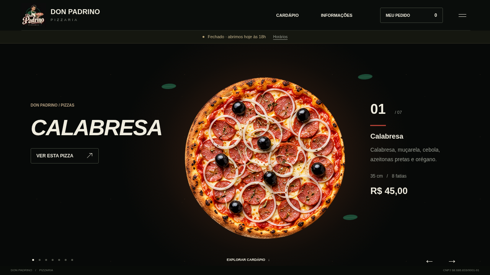
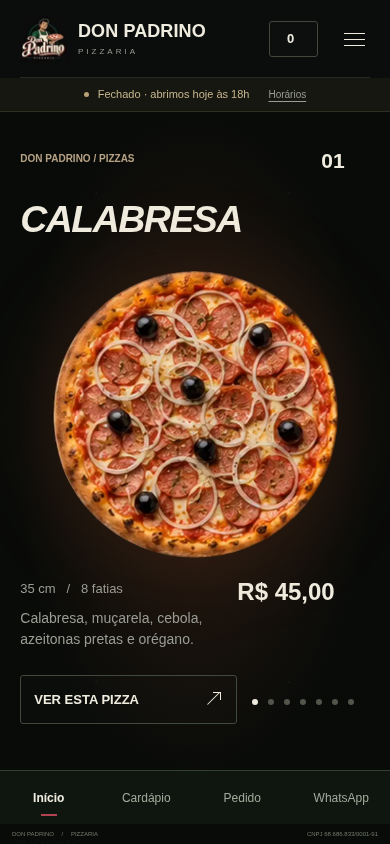
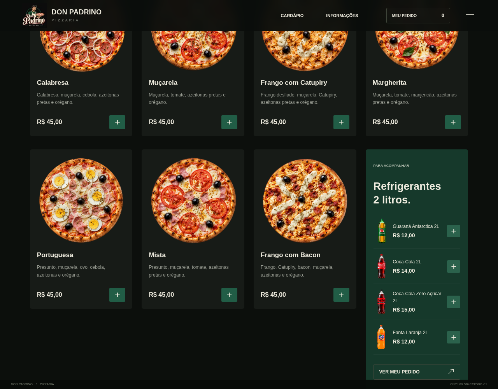

# Don Padrino Pizzaria

Site responsivo reconstruído a partir dos vídeos desktop e mobile fornecidos pelo proprietário. Inclui cardápio, carrinho, pedido sem cadastro, mensagem para WhatsApp, administração e acompanhamento com eventos em tempo real.

## Prévia do site

As imagens abaixo mostram a implementação atual e podem ser visualizadas diretamente neste repositório.

### Computador



### Celular



### Refrigerantes no cardápio



## Executar

Requer **Node.js 24.5+** (SQLite nativo). O servidor de produção não depende de pacotes externos.

```bash
cd /workspace/Don-Padrino
npm ci --cache /tmp/padrino-npm
npm run dev
```

Os comandos de início usam o proxy configurado no ambiente e os certificados do sistema, preservando a verificação TLS. O servidor usa a porta 3000. Para iniciar sem o modo de observação, use `npm start`. `PORT`, `HOST` e `DATA_DIR` são opcionais. Os arquivos `.env` não são carregados automaticamente: exporte as variáveis no serviço, ou use `node --use-env-proxy --use-system-ca --env-file=.env server.mjs`.

## Ativar sua conta administrativa

O painel não tem link no menu nem no rodapé públicos. O endereço direto é `/admin`, e as APIs administrativas exigem sessão autenticada.

### Pelo Railway

1. No serviço Don-Padrino, abra **Variáveis** e adicione **`ADMIN_INITIAL_PASSWORD`** com uma senha pessoal de 12 a 256 caracteres. Cadastre o valor somente no painel privado do Railway, nunca no chat, Git ou arquivos públicos. Use uma senha longa e exclusiva.
2. Aplique as alterações com **Deploy**. Na primeira inicialização, se ainda não houver administrador, a aplicação salva somente o hash scrypt da senha no SQLite do volume `DATA_DIR`.
3. Acesse `https://don-padrino-production.up.railway.app/admin` no computador e entre com o usuário **`admin`** e a senha cadastrada. Salve esse endereço nos favoritos.
4. Após confirmar o acesso, remova a variável `ADMIN_INITIAL_PASSWORD` do Railway e aplique a alteração. O hash permanece no volume e o login continua funcionando.

Essa variável **não redefine uma senha já cadastrada**, mesmo em novos deploys. Para recuperar ou redefinir o acesso existente, use o comando de terminal abaixo no mesmo volume de dados. Não crie outra cópia vazia do banco para alterar a senha.

### Pelo terminal privado

Em um terminal privado, na pasta do projeto:

```bash
npm run admin:create
```

Cadastre uma senha com pelo menos 12 caracteres. A digitação é oculta e somente o hash com salt/scrypt é armazenado. Não existe senha padrão. Acesse a rota **`/admin`** com o usuário **`admin`** e a senha cadastrada. O mesmo comando recupera o acesso do proprietário e encerra somente as sessões dessa conta; os acessos da equipe continuam independentes. Não coloque a senha em chat, Git, argumentos de linha de comando ou scripts de instalação.

### O que guardar e como acessar novamente

Guarde no seu gerenciador de senhas o endereço `https://don-padrino-production.up.railway.app/admin`, o usuário `admin` e sua senha pessoal. No computador, abra esse endereço no navegador, preencha os dois campos e clique em **Entrar no painel**. A sessão dura até 12 horas; use **Sair** ao terminar em um computador compartilhado. Para mudar a senha depois, use **Minha senha**. Não é necessário deixar a variável de inicialização na hospedagem depois do primeiro acesso confirmado.

Se aparecer “Usuário ou senha incorretos” mesmo após definir a variável, já havia uma conta nesse volume: a variável não substitui uma senha existente. Recupere pelo terminal privado no mesmo volume de dados com `npm run admin:create`; não apague o banco nem o volume. Preserve também seus acessos ao Railway e GitHub para manutenção e recuperação.

### Contas individuais para atendentes

1. Entre como proprietário e abra **Equipe**.
2. Cadastre nome, usuário exclusivo e senha temporária de pelo menos 12 caracteres.
3. Marque separadamente **Alterar etapas, previsão e cancelar pedidos** e/ou **Confirmar pagamentos recebidos**. Sem marcar nenhuma, a conta somente consulta os pedidos e seus valores.
4. Clique em **Criar conta** e forneça o endereço `/admin`, usuário e senha temporária por um canal privado. A atendente precisa criar uma senha pessoal antes de consultar os pedidos. Ela entra novamente após a troca.
5. Para suspender o acesso, desmarque **Conta ativa** e salve. Para recuperar a senha de uma atendente, informe uma nova senha temporária e salve. Qualquer alteração de acesso encerra imediatamente as sessões dessa conta; as outras permanecem conectadas.

Somente o proprietário gerencia contas e configurações. A atendente não pode se promover a proprietária nem alterar outros acessos. Confirmação de pagamentos e operação dos pedidos são permissões independentes, verificadas no servidor. O painel do proprietário mostra as últimas 100 alterações de contas, configurações e pedidos, com usuário e horário. A senha de outra pessoa nunca é exibida; só pode ser redefinida. Não existe cadastro público nem conta de cliente.

Ao atualizar uma instalação antiga, a senha administrativa existente é preservada e associada automaticamente ao usuário `admin`. As sessões antigas sem usuário são encerradas uma única vez. Pedidos, configurações e dados do volume são mantidos.

No painel você pode:

- Conferir itens, observações, contato, endereço e valores dos pedidos.
- Confirmar o pagamento, iniciar o preparo e marcar pronto, em entrega ou concluído.
- Copiar o link individual para o entregador compartilhar a localização.
- Definir uma previsão específica de tempo e cancelar pedidos.
- Pausar vendas, editar endereço/avisos, taxas, prazos e exceções por faixa de CEP.

## Operação configurada

- CNPJ informado: **68.686.833/0001-91**.
- WhatsApp: **(21) 99456-8096**.
- Instagram: **[@donpadrinorj](https://www.instagram.com/donpadrinorj/)**, em azul no site.
- Retirada: **Travessa Projetada C, nº 8 — Dumas, Santa Cruz, Rio de Janeiro — RJ, 23550-170**.
- Abertura automática: **quinta a domingo, 18h às 00h**, em `America/Sao_Paulo`. O servidor impede pedidos fora desse horário; o painel permite suspender a restrição, para uma abertura excepcional.
- Pizzas: **35 cm, 8 fatias, R$ 45**.
- Guaraná Antarctica 2L: **R$ 12**. Coca-Cola 2L: **R$ 14**. Coca-Cola Zero Açúcar 2L: **R$ 15**. Fanta Laranja 2L: **R$ 12**.
- Taxas iniciais: **Santa Cruz R$ 6; Urucânia R$ 7; Sepetiba R$ 9**. São valores iniciais definidos a pedido do proprietário; a margem depende dos custos reais e deve ser acompanhada na operação.
- Preparo estimado: **35 min**, mais deslocamento inicial de **15 min em Santa Cruz, 18 min em Urucânia e 25 min em Sepetiba**. São estimativas editáveis, sem integração com trânsito. A previsão começa no início do preparo e é recalculada ao sair para entrega. O administrador pode substituir a previsão de um pedido.

Alterar o texto do horário no painel não altera os dias da regra automática em `hours.mjs`. Os valores são calculados no servidor em centavos; o cliente não define o preço final. As alterações de taxa só afetam novos pedidos.

## Horário de funcionamento e fechamento automático

A loja recebe novos pedidos de **quinta a domingo, das 18h até antes de 00h**, no horário de Brasília (`America/Sao_Paulo`). Segunda, terça, quarta e os períodos de manhã/tarde ficam fechados para novas vendas.

- A página mostra discretamente se a pizzaria está aberta e quando abre novamente: hoje, amanhã ou o próximo dia de funcionamento.
- O cardápio continua disponível, e o carrinho pode ser montado e fica salvo no navegador. Fora do horário, a finalização é bloqueada. Não há agendamento nem envio automático de um carrinho ao abrir.
- O navegador consulta o atendimento a cada 30 segundos e ao retornar à página. Ao atingir a meia-noite conhecida pelo servidor, bloqueia a finalização mesmo se a conexão cair.
- O servidor confere o atendimento antes do processamento e imediatamente antes de registrar um novo pedido. Uma página antiga ou o relógio/fuso do celular não autorizam pedidos fora do horário.
- Pedidos já registrados continuam disponíveis para pagamento, preparo e acompanhamento depois do fechamento.
- O administrador pode pausar os pedidos imediatamente ou abrir uma exceção de horário pelo painel. Uma pausa prevalece sobre a abertura excepcional.

As regras e a próxima abertura são calculadas em `hours.mjs`; o endpoint `/api/availability` informa o estado atual. Para alterar os dias e horários automáticos, ajuste esse módulo. O texto de horário editável no painel é apenas informativo.

## Fluxo do pedido

1. O cliente monta o carrinho, informa nome/WhatsApp e escolhe retirada ou entrega. Entrega exige CEP, rua, número, bairro, cidade e ponto de referência.
2. O servidor consulta o CEP, calcula a taxa e registra o pedido no SQLite. Repetir a mesma tentativa não cria outro pedido.
3. O cliente recebe um número e um link privado, sem criar conta. O pagamento fica pendente.
4. Na tela de acompanhamento, o botão **Combinar pagamento no WhatsApp** abre `wa.me/5521994568096` com os itens, observações, endereço, taxa e total. O cliente ainda precisa tocar em **Enviar** no WhatsApp. Não há chat simulado nem confirmação automática de pagamento.
5. A pizzaria confirma o recebimento e atualiza as etapas. O cliente recebe eventos SSE e vê o progresso sem recarregar a página.

O sistema não cobra Pix/cartão nem confirma transações bancárias: pagamento e eventual reembolso são conferidos pela pizzaria.

## CEP e frete

O servidor consulta **`https://viacep.com.br`** e aceita apenas as regiões configuradas no município do Rio de Janeiro/RJ. O CEP **23550-170** também possui cadastro local com o endereço confirmado pelo proprietário. Este cadastro não depende do serviço externo; os demais CEPs dependem do ViaCEP.

A lista de regiões atendidas fica apenas na administração, sem anúncio na página pública. O bairro retornado pelo ViaCEP determina a taxa. Urucânia e Dumas podem aparecer como Santa Cruz; nesse caso vale a taxa de Santa Cruz. Para outra cobrança em um conjunto específico de CEPs, cadastre uma faixa no painel. Faixas têm prioridade, não podem se sobrepor e taxa zero concede entrega grátis.

Se o CEP estiver fora da região, não existir ou a consulta estiver indisponível, a entrega não é fechada com taxa incerta. O cliente pode tentar novamente, escolher retirada ou consultar o WhatsApp. **Não são inventadas distâncias nem áreas atendidas.**

## Localização do entregador

Depois de marcar **Entregue ao entregador**, copie o link no painel e envie-o ao profissional. Ele abre a rota `/entregador/<chave-privada>` no celular e toca em **Ativar localização**. O navegador pede autorização.

O site transmite o GPS real recebido pelo navegador, com precisão e horário do último sinal. O cliente vê a posição no OpenStreetMap. Não há movimentação simulada. O botão de parar remove a posição compartilhada; a conclusão/cancelamento também a remove e impede novas posições.

**Requisitos reais:** HTTPS, localização autorizada, conexão ativa e página do entregador aberta. O navegador pode suspender o GPS quando a tela é bloqueada ou o aplicativo vai para segundo plano. O site sinaliza uma posição sem atualização há mais de 2 minutos. Para rastreamento contínuo em segundo plano será necessário um aplicativo de entregador ou uma plataforma de logística — não é uma capacidade garantida por uma página web.

## Produção

Use um host com Node.js 24.5+, processo persistente e **disco/volume persistente**. SQLite é adequado a uma instância do servidor; não publique este backend em hospedagem somente estática ou em instâncias sem armazenamento permanente.

1. Instale dependências com `npm ci`.
2. Configure `DATA_DIR` em um volume privado persistente e execute `npm run admin:create` nesse mesmo diretório de dados.
3. Configure `PUBLIC_ORIGIN=https://seu-dominio.com.br` e `COOKIE_SECURE=true` atrás de um proxy HTTPS.
4. Inicie com `npm start` usando o gerenciador de processos da hospedagem.
5. Permita conexões de saída a `viacep.com.br`. O navegador precisa acessar `www.openstreetmap.org` para exibir o mapa; os links externos usam `wa.me` e `www.instagram.com`.
6. O proxy deve manter SSE sem buffering e sem cache nas rotas `/api`. Um timeout maior que 60 s é recomendado; há heartbeat a cada 20 s.
7. Faça backup consistente do SQLite em `DATA_DIR` (API de backup SQLite, ou serviço parado com os arquivos SQLite/WAL). Preserve esse volume ao atualizar o código. Ele contém dados pessoais de clientes e os hashes das senhas e registros de acesso; não deve ser servido publicamente.
8. Faça um pedido de retirada e de entrega no domínio real, confirme o pagamento manualmente e teste o GPS em um celular do entregador antes de abrir vendas.

Não publique a pasta `data`, não compartilhe links privados de clientes ou entregadores e proteja o acesso ao painel. A política de privacidade básica está em `/privacidade` e deve ser mantida conforme a operação real.

## Validação

```bash
npm test
npm run test:e2e
```

Os testes de API verificam preços autoritativos, frete, pedidos, repetição de envio, persistência após reiniciar, autenticação, origem de requisições, etapas, SSE, GPS e horário de funcionamento. Os testes de navegador usam Chromium em `/usr/bin/chromium`; configure `CHROMIUM_PATH` se estiver em outro local.

Os testes criam **bancos isolados temporários**. Consultas externas de CEP usam respostas de teste (`tests/postal-fixture.mjs`); o teste de GPS usa a emulação de localização do navegador. Esses testes não comprovam disponibilidade do ViaCEP, precisão de GPS físico ou recebimento de mensagens pelo WhatsApp. Nenhuma mensagem externa é enviada pelos testes.

## Arquivos principais

- `server.mjs`: HTTP, autenticação, API, SSE e entrega dos arquivos estáticos.
- `store.mjs`: SQLite, catálogo, preços e taxas.
- `hours.mjs`: regras de funcionamento, fechamento e próxima abertura.
- `postal.mjs`: consulta/cadastro de CEP e cache.
- `public/app.js`: landing page, cardápio e checkout.
- `public/effects.js`: feedback visual de inclusão, cliques e entrada dos cards, independente da persistência do carrinho.
- `public/admin.js`: administração.
- `public/order.js`: acompanhamento e compartilhamento GPS.
- `public/style.css`: layout responsivo, estados e animações, com suporte à redução de movimento.
- `public/assets`: pizzas restauradas em alta resolução a partir das referências dos vídeos, com recorte transparente, e imagens ilustrativas realistas das quatro bebidas. A restauração pode reconstruir pequenos detalhes da textura; fotos originais dos produtos reais podem substituir essas imagens. O carrossel troca automaticamente a cada 7,5 segundos e usa rotação/flutuação suaves; as animações respeitam a preferência de redução de movimento do dispositivo.

O envio do código ao GitHub não coloca o site em uma hospedagem. O deploy e a conexão de domínio são etapas separadas. A restauração do ambiente em uma nova tarefa também depende da publicação pela interface.

Os símbolos de dinheiro, Pix e cartão em `public/assets/payment-*.svg` são do [Font Awesome Free 6.7.2](https://fontawesome.com/), licenciados sob [CC BY 4.0](https://creativecommons.org/licenses/by/4.0/). Os avisos de autoria foram preservados nos arquivos SVG.

As quatro bebidas usam imagens individuais em WebP, com miniaturas leves para o cardápio/carrinho e arquivos maiores para a foto ampliada. As garrafas têm flutuação suave e inclinação/destaque ao passar o mouse ou focar com teclado. Clique na foto ou no nome para ampliar e adicionar unidades. A preferência de redução de movimento desativa as animações.

Ao incluir um produto, a imagem faz um trajeto até o carrinho, o contador recebe um destaque breve e o botão + confirma a ação. Ondas de clique e entradas suaves dos cards complementam as interações. Os efeitos têm duração curta, limite de elementos simultâneos, não bloqueiam novos cliques e respeitam a redução de movimento. O carrinho é atualizado antes de qualquer efeito visual.
